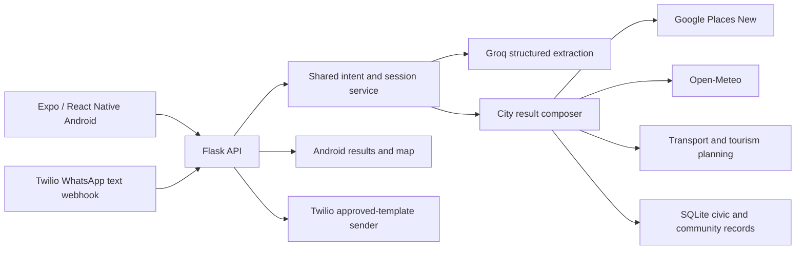

# Smart Nagrik

**Your City. Your Companion. Your Confidence.**

Innovators Conclave 2026 · Prototype city: Bengaluru, Karnataka

Smart Nagrik brings everyday city questions into one Android experience. A newcomer can ask about a place to stay, food, weather, a journey or a short visit, then explore sourced results on an inline map. Residents can also save local issue reports and support concerns shared by their community.

## Why this exists

City information is scattered across maps, forecasts, transport sites and civic portals. That fragmentation is hardest when someone is new to a city or needs help quickly. Smart Nagrik interprets the situation first, retrieves relevant information, and presents a useful next step without pretending that an unverified price, route or official status is known.

Imagine arriving in Bengaluru at **4 AM** with a budget, a need for a room and something to eat. The assistant can keep those needs together, find actual place listings near a named area, show their locations and open Directions. It explicitly leaves room availability, price and immediate check-in for the property to confirm.

## What the prototype does

| Area | Implemented behavior |
| --- | --- |
| Understanding | Groq GPT-OSS 120B extracts validated intent and constraints; narrow known actions use deterministic rules. Bounded session context supports follow-ups and contextual reply tiles. |
| City discovery | Google Places (New) supplies Bengaluru hotel, restaurant and useful-place listings, matching photos and attribution. Cards open Google Maps Directions. |
| Weather | Open-Meteo supplies Bengaluru forecasts with India-local time handling and concise summaries. |
| Transport | Named endpoints can be resolved to sourced coordinates and shown on an expandable inline map. External Google Maps handles navigation. Small static examples label sample frequencies **Demo / Simulated**. |
| Tourism | A bounded planner orders sourced attractions and optional food stops, responds to duration and stated preferences, and supports short refinements. Visit times are estimates. |
| Civic and community | SQLite saves user-confirmed reports, sanitised optional photos, status history, public posts and reversible **With You** support. Only public reports with confirmed coordinates appear as map markers. |
| Channels | Expo/React Native Android and a signed Twilio WhatsApp text webhook use the same Flask processing service. The committed WhatsApp sender uses its configured approved template; live delivery of a generated answer is still to be verified. |

The existing Bengaluru home screen, Vidhana Soudha imagery and scroll transition lead into result cards and a compact map that expands in place. Geographic markers come from provider records or confirmed public reports. The map does not draw an invented road route.

## Architecture



The backend keeps API keys server-side. WhatsApp webhooks validate Twilio signatures, deduplicate inbound message IDs in process memory and queue slow processing outside the acknowledgement request. See [backend architecture and setup](backend/README.md) and the [final implementation report](backend/PRE_WHATSAPP_IMPLEMENTATION.md) for contracts and limits.

## Technology

| Layer | Project dependencies |
| --- | --- |
| Android | Expo SDK 58, React Native 0.88, React 19.3, TypeScript 6, `react-native-maps` 1.29 |
| Backend | Python, Flask 3.1 range, Pydantic 2.14, Groq Python SDK 1.7, Twilio Python SDK 9.11, Pillow 12.1–13.x |
| External data | Groq GPT-OSS 120B, Google Places API (New), Google Maps Directions URLs, Open-Meteo |
| Local records | SQLite with transactions for civic reports, photos, posts and support |

## Screenshots

**Real app screenshots coming soon.** The repository includes the genuine [Bengaluru hero asset](frontend-app/assets/images/hero-bengaluru.jpg), but no captured device screens. The team can add actual Expo Go captures of the home screen, place results, expanded map, itinerary, report form and community feed under `docs/screenshots/` and link them here.

## Run locally

Use Python and Node.js versions compatible with the project dependencies. In PowerShell, from the repository root:

```powershell
cd backend
python -m venv .venv
.\.venv\Scripts\python -m pip install -r requirements.txt
Copy-Item .env.example .env
# Fill in the server-side keys you intend to use; .env stays outside Git.
.\.venv\Scripts\python app.py
```

The Flask API defaults to `http://127.0.0.1:5000`; check `/health`. `GROQ_API_KEY` and `GROQ_MODEL=openai/gpt-oss-120b` configure extraction. `GOOGLE_PLACES_API_KEY` enables place discovery. Weather needs no key. Optional Twilio settings are `TWILIO_ACCOUNT_SID`, `TWILIO_AUTH_TOKEN`, `TWILIO_WHATSAPP_NUMBER`, `TWILIO_CONTENT_SID`, `TWILIO_CONTENT_VARIABLES` and the exact `TWILIO_PUBLIC_WEBHOOK_URL`. Keep these in [backend/.env.example](backend/.env.example) format and supply real values only to the ignored local `.env`.

In another terminal:

```powershell
cd frontend-app
npm ci
Copy-Item .env.example .env
# Set EXPO_PUBLIC_API_URL to the backend URL reachable from your Android device.
npx expo start
```

Open the project in Expo Go. For a physical device, use your laptop's reachable LAN address and set `SMART_NAGRIK_HOST=0.0.0.0` for local development, or expose port 5000 through an optional Cloudflare Tunnel:

```powershell
cloudflared tunnel --url http://localhost:5000
```

Tunnel hostnames can change. Use the current HTTPS hostname for both the frontend API URL and Twilio's inbound `/twilio/webhook` setting, with the exact webhook URL in the backend environment. Never put server credentials in `EXPO_PUBLIC_*` variables. [Frontend setup](frontend-app/README.md) documents Expo assets and device startup.

## Demo flow

1. Ask for accommodation and food near a named Bengaluru locality; inspect separate sourced cards and Directions.
2. Ask for a journey and expand the inline map to inspect resolved endpoints. Any example frequency is labelled simulated.
3. Request a short tourism plan, then shorten it or change an interest.
4. Describe a pothole, review the draft in Report Issue, confirm its location and submit. The saved Smart Nagrik reference appears in My Reports.
5. Make a deliberately public test report with confirmed coordinates; find its marker and use **With You** from the community result.

The civic flow saves a Smart Nagrik community record. It does not submit to a government department.

## Verification and current limits

The integrated implementation report recorded **169 backend tests**, **40 frontend tests**, passing TypeScript and ESLint checks, and bounded live tourism calls through Groq, Places and Open-Meteo. These are source and provider checks; physical Android interaction and live WhatsApp delivery require separate acceptance on a phone. Run the automated checks with:

```powershell
cd backend
.\.venv\Scripts\python -m unittest discover -q

cd ..\frontend-app
npm run test:results
npx tsc --noEmit
npm run lint
```

Current boundaries: Bengaluru is the only supported city; tourism plans and chat context expire in memory; the map has no calculated road-route geometry; transport examples are not live BMRCL/BMTC tracking; civic reports are not official complaints. WhatsApp voice, multilingual delivery and a secure Android handoff remain future work. [Milestone reports](backend/MILESTONE0412.md) explain source, privacy and provider limits in detail.

## Team and credits

Aditya contributed the Android frontend design. The student team's work spans the Flask backend, intent and city integrations, mapping, civic/community workflows and the original Twilio messaging proof of concept. Git history preserves the existing contributors' commits; this README does not assign undocumented individual authorship. Place, photo and forecast results display their provider attribution in the app.
